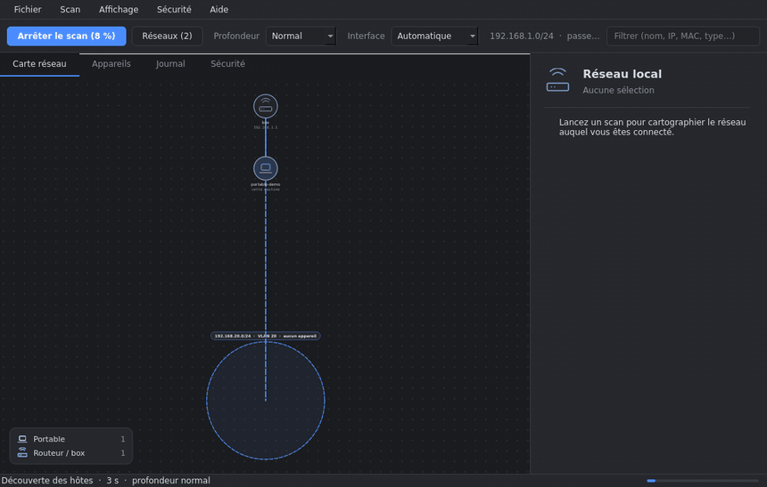
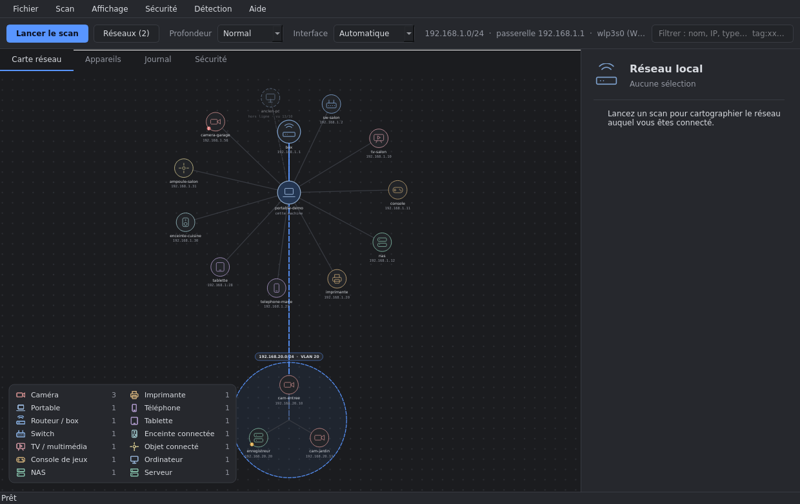
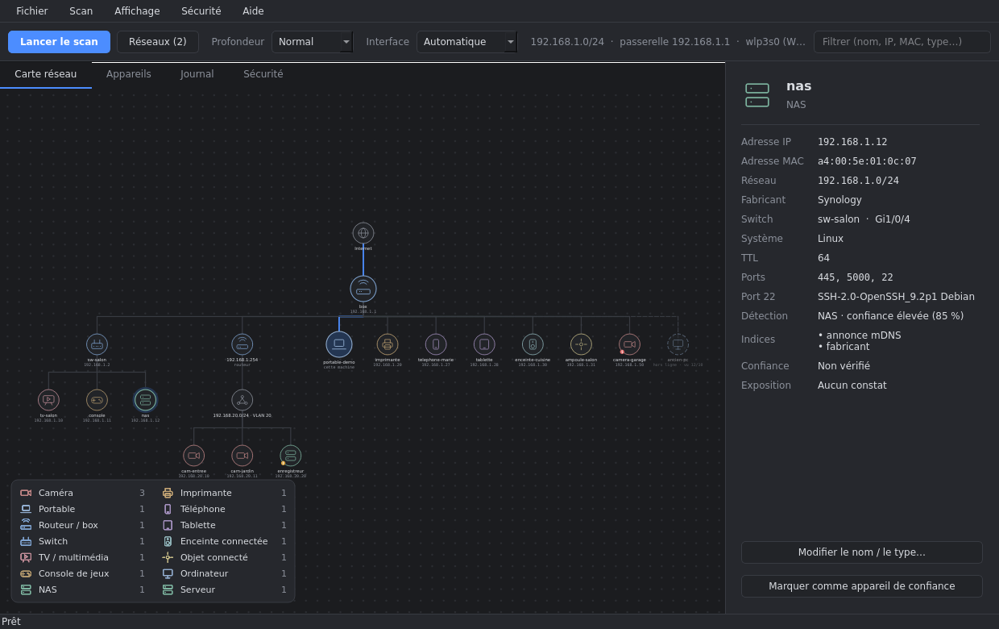
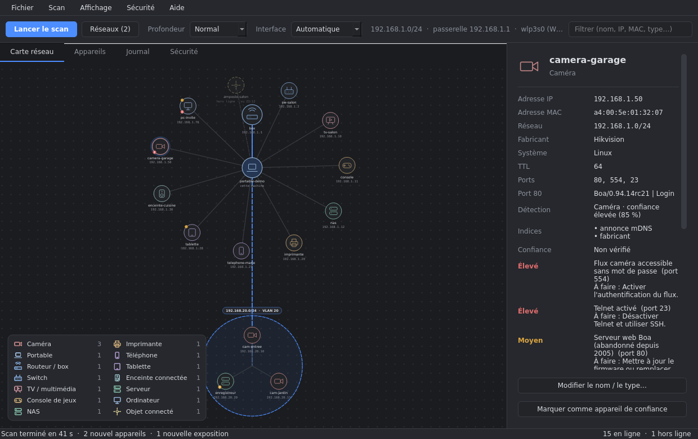
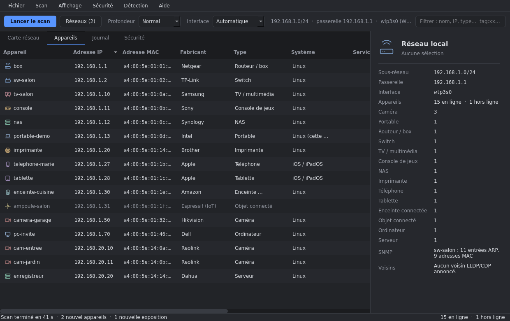
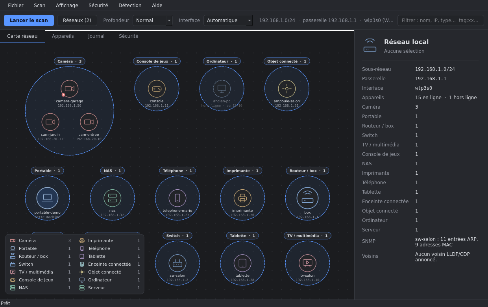
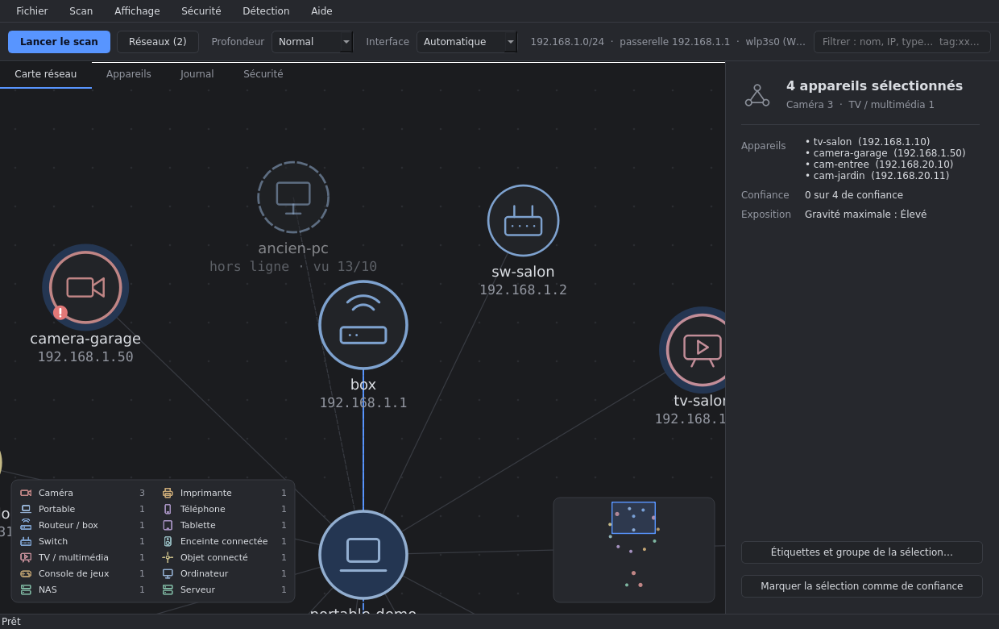
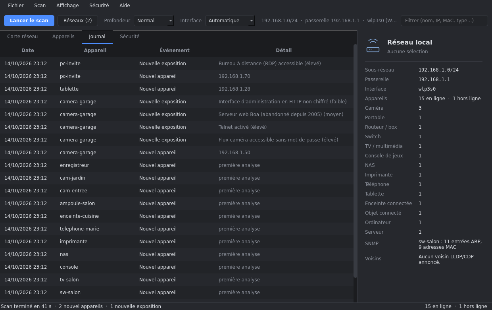
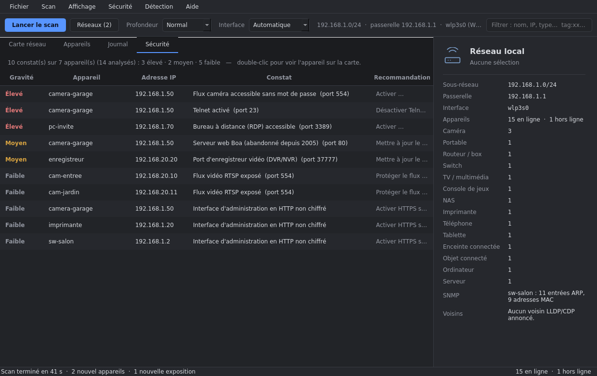
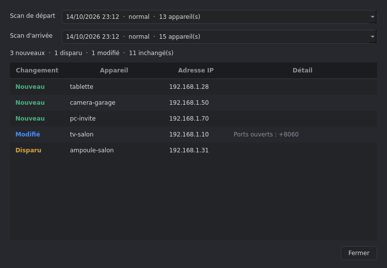

# Panther

**Français** · [English](README.md)

**Scanner et cartographie de réseau local** : Panther détecte les appareils du réseau (téléphones, imprimantes, TV,
caméras, NAS, switchs…), dessine la carte, suit leur présence dans le temps, gère plusieurs réseaux et VLAN,
compare deux scans et exporte des rapports PDF. Le moteur de scan est **écrit à la main en Python standard**
(pas de nmap, pas de root pour l'essentiel) ; seule l'interface graphique utilise PyQt6.

> Les captures de ce dépôt viennent d'un **réseau fictif** (`tools/make_screenshots.py`), jamais d'un vrai réseau.

## Fonctions

- **Détection des appareils** : découverte ARP, SSDP/UPnP, mDNS/Bonjour, WS-Discovery (caméras ONVIF, imprimantes, PC Windows),
  NetBIOS, titre et `realm` des pages HTTP(S), **certificat HTTPS** (marque, modèle, expiration), baux DHCP locaux ; fabricant (base IEEE), ports, bannières, système,
  modèle lisible (« iPhone14,2 » → « iPhone 13 Pro ») ; classification **par score** avec niveau de confiance et liste des indices
  (« pourquoi c'est une imprimante »), un logo par type (téléphone, tablette, TV, imprimante, console, enceinte,
  caméra, NAS, switch, routeur…). Nom et type corrigeables à la main, et **règles de détection personnalisées** dans un fichier
  JSON (`docs/REGLES.md`) : clic droit sur un appareil → « Créer une règle de détection… ».
- **Trois cartes** : *étoile* autour de cette machine, *hiérarchique* (Internet → box → switch → appareils) ou *regroupée par
  type d'appareil* ; votre chemin vers Internet est tracé en bleu, les positions des nœuds sont mémorisées par disposition.
  Une **mini-carte** apparaît quand on zoome (clic ou glisser pour se déplacer), **Maj + glisser** sélectionne plusieurs
  appareils (ou **Ctrl + clic**) et la sélection peut être marquée de confiance ou étiquetée d'un coup ; *Affichage →
  Centrer sur la sélection* (`Ctrl+Maj+0`) retrouve un appareil.
- **Plusieurs réseaux et VLAN** : plages saisies à la main ou détectées (routes, interfaces 802.1Q, passerelles),
  chemin traceroute, avertissement si un réseau ne répond pas, **SNMP** en lecture seule (adresses MAC et ports de
  switch d'autres VLAN), voisins **LLDP/CDP**.
- **IPv6 (adresses)** : les adresses IPv6 de chaque appareil (lues dans la table des voisins du noyau après un ping multicast) sont affichées dans le panneau et exportées ; la découverte reste en IPv4.
- **Profils de scan** : plages, profondeur, interface, hôtes SNMP et options enregistrés sous un nom (Scan → Profils de scan) ; un profil ne contient jamais de secret et ne donne jamais le consentement à l'analyse de sécurité.
- **Surveillance** : découverte par **ARP** (scan normal ≈ 10 s), scan de **présence** (≈ 2 s, presque aucun trafic) qui réutilise
  les détails du dernier scan complet, arrêt du scan, profondeur rapide / normal / approfondi, scan automatique
  (présence + un scan complet par heure), appareils *hors ligne*, *nouveaux* appareils avec notification de bureau.
- **Historique** (SQLite) : présence sur les derniers scans, disponibilité, **courbe de latence** (le ping de chaque scan complet), journal des événements (nouvel appareil,
  changement d'IP, hors ligne, retour…), appareils **de confiance**, **comparaison de deux scans**, **fusion de doublons**
  (une MAC « privée » qui change : suggestion automatique, alias conservés), taille et purge configurables.
- **Analyse de sécurité optionnelle, en lecture seule** : ports sensibles, services accessibles sans mot de passe,
  services obsolètes, avec gravité et recommandation ; nouvelles expositions et expositions corrigées dans le journal.
- **Organisation** : étiquettes, notes et groupes par appareil (« enfants », « domotique »), filtres associés ; réveil à distance
  (Wake-on-LAN) d'un appareil hors ligne.
- **Alertes** (webhook Discord / Slack / ntfy / JSON, ou e-mail SMTP) : un message groupé par scan pour un nouvel appareil, une
  nouvelle exposition ou un appareil de confiance hors ligne ; l'URL du webhook et le mot de passe SMTP sont rangés dans le
  trousseau du système (ou un fichier privé), jamais dans les réglages.
- **Rapports** : PDF (résumé, carte, changements, appareils, exposition), Markdown (sécurité), JSON et CSV enrichis (confiance,
  étiquettes, historique), carte en PNG ou SVG ; **rapport PDF planifié** (tous les jours ou toutes les semaines) dans un
  dossier choisi, avec suppression des plus anciens (menu Fichier → « Rapports planifiés… »).
- **Base des fabricants** : mise à jour depuis le menu (IEEE), avec confirmation.
- **Vie privée** : écoute seule (aucune sonde envoyée), menu *Tout effacer* pour l'historique, communauté SNMP dans le trousseau
  du système, dossier de données en mode 700 et base/journal en mode 600 (voir [SECURITY.md](SECURITY.md)).
- **Accessibilité** : thème qui suit le système (ou sombre, clair, **contraste élevé** ; les tests vérifient les rapports de
  contraste WCAG de chaque thème), **taille du texte** réglable, focus clavier visible, carte parcourable aux flèches (Entrée
  modifie, Échap désélectionne, `+`/`−` zoom) et onglet *Appareils* qui liste les mêmes appareils sous forme de tableau pour
  les lecteurs d'écran. Un **assistant de premier lancement** (langue, usage responsable, apparence, options de scan) se
  rouvre depuis *Aide*.
- **Interfaces** : fenêtre Qt (français ou anglais), interface web locale, ligne de commande.

## Captures

| Carte en étoile | Carte hiérarchique |
|---|---|
|  |  |
| **Détails d'un appareil** | **Liste des appareils** |
|  |  |
| **Regroupée par type** | **Zoom, mini-carte, sélection multiple** |
|  |  |
| **Journal** | **Analyse de sécurité** |
|  |  |
| **Comparer deux scans** | **Rapport PDF** |
|  |  |

## Installation

Linux, Python ≥ 3.12. Aucun droit root pour scanner (sauf l'écoute LLDP/CDP, voir plus bas).

**Depuis les sources**

    ./run.sh                  # crée .venv, installe PyQt6 au premier lancement, ouvre la fenêtre

**Avec pipx**

    pipx install .            # ou : pipx install dist/panther_netscan-0.1.0-py3-none-any.whl
    panther

**Paquet Debian / Ubuntu** (utilise le `python3-pyqt6` du système, pas de Qt embarqué)

    ./packaging/build-deb.sh
    sudo apt install ./dist/panther-netscan_0.1.0_all.deb

## Utilisation

    panther                          # fenêtre
    panther --web [--port 8765]      # interface web locale (127.0.0.1 uniquement)
    panther --cli                    # tableau dans le terminal
    panther --cli --depth rapide --target 192.168.20.0/24 --iface eth0
    panther --cli --security         # + analyse de sécurité (lecture seule)
    panther --verbose                # journal détaillé sur la console
    panther --demo                   # réseau fictif pour essayer l'interface (aucun scan, aucune configuration touchée)
    panther --lang en                # langue de l'interface (fr ou en) ; défaut : le choix enregistré, puis celle du système

Dans la fenêtre : `Ctrl+R` lance le scan, `Ctrl+.` l'arrête, `Ctrl+0` recentre la carte, `Ctrl+Maj+0` la centre sur la sélection ; clic droit sur un appareil
pour le renommer, changer son type ou le marquer de confiance. La langue (français / English) se choisit dans le menu
*Affichage → Langue* (prise en compte au prochain démarrage).

## Fonctionnement

| Module (`panther/`) | Rôle |
|---|---|
| `scanner.py` | moteur : découverte ARP/TCP, profils de profondeur, présence, annulation, analyse de chaque appareil |
| `discovery.py`, `dhcp.py` | SSDP/UPnP, mDNS/Bonjour, WS-Discovery (analyse des paquets écrite à la main) ; baux DHCP |
| `fingerprint.py`, `rules.py`, `models.py` | fabricant (OUI), système, classification par score ; règles personnalisées ; noms de modèles |
| `networks.py`, `topology.py` | interfaces, VLAN, plages ; traceroute, voisins LLDP/CDP |
| `snmp.py`, `snmpv3.py` | client SNMP en lecture seule : v2c, et v3 authNoPriv (BER et USM écrits à la main) |
| `profiles.py` | profils de scan enregistrés |
| `security.py` | règles d'exposition et vérifications sans authentification |
| `history.py`, `store.py`, `compare.py`, `identity.py` | base SQLite (historique, journal, confiance, positions, instantanés, alias), réglages manuels, comparaison, doublons probables |
| `layout.py` | arbre de la topologie et disposition hiérarchique |
| `demo.py` | mode démonstration : réseau fictif, faux moteur de scan, configuration temporaire |
| `i18n.py`, `lang_en.py`, `labels.py` | traduction (texte source français, catalogue anglais), libellés des types d'appareils |
| `ui/` (`theme`, `icons`, `util`, `widgets`, `mapview`, `dialogs`, `settings_dialogs`, `wizard`, `window` + un mixin par rôle : `scan`, `mapctl`, `tables`, `panel`, `devices`, `reports`, `prefs` ; `app`), `gui.py` | interface Qt découpée par rôle (`gui.py` ne fait que réexporter les noms publics) |
| `reportpdf.py`, `log.py` | rapport PDF, journal d'erreurs |
| `server.py`, `static/` | interface web locale |

Données : `~/.config/Panther/` (`panther.db` = historique, `devices.json` = noms et types choisis à la main,
`rules.json` = règles de détection, `panther.log` = journal d'erreurs : adresses et noms d'appareils, jamais de mot de passe ni de communauté SNMP ; `--verbose`
pour le détail) ;
`panther/oui.txt` = base des fabricants.

### Langues

Le français est la langue source de chaque texte ; `panther/lang_en.py` contient le catalogue anglais.
`python3 tools/i18n_check.py` (et `tests/test_i18n.py`) échouent si un texte n'a pas de traduction, si une entrée est
périmée ou si les `{champs}` diffèrent, et un test hors écran parcourt toute l'interface anglaise à la recherche de
français oublié. Les textes *enregistrés* (journal des événements, constats de sécurité de l'historique) gardent la langue
dans laquelle ils ont été écrits.

### Ce que fait l'analyse de sécurité

Désactivée par défaut, activée par le menu *Sécurité* après un message d'information. Panther regarde les ports
ouverts et les bannières, et envoie **une seule requête de lecture sans identifiant** à quelques services (PING
Redis, `version` Memcached, `GET /` Elasticsearch, `GET /version` Docker, `DESCRIBE` RTSP) pour savoir s'ils
répondent sans mot de passe. Il **n'essaie aucun identifiant, ne devine aucun mot de passe, n'exploite aucune
faille**. Les versions annoncées par les bannières sont des indices : sur Linux, les correctifs sont souvent
rétroportés, la version affichée ne prouve donc pas une faille.

### Écoute seule

Menu *Sécurité → Écoute seule* (ou `panther --cli --depth ecoute`) : Panther n'envoie **rien** (ni ARP forcé, ni connexion
TCP, ni requête SSDP/mDNS, ni résolution de noms, ni SNMP, ni traceroute, ni analyse de sécurité). Il lit la table des voisins
du noyau, les baux DHCP locaux et reprend les détails du dernier scan complet. Les appareils jamais vus apparaissent avec
leur seul fabricant (MAC) ; une entrée ancienne du noyau peut afficher quelques minutes un appareil déjà parti.

### SNMP et LLDP/CDP (optionnels)

SNMP **v3** est géré au niveau *authNoPriv* (utilisateur + mot de passe, HMAC-SHA/SHA-256/MD5, chaque requête signée et chaque réponse vérifiée ; les clés sont dérivées comme dans le RFC 3414 et contrôlées avec ses vecteurs de test). Il n'y a pas de chiffrement (la bibliothèque standard n'a pas AES) : les réponses circulent en clair, à réserver à un réseau d'administration de confiance. Le mot de passe v3 va dans le trousseau comme la communauté v2c.

La communauté SNMP est rangée dans le **trousseau du système** (`secret-tool`, GNOME Keyring / KWallet) quand il est
installé, sinon dans un fichier privé en mode 600 ; elle n'est jamais écrite dans les réglages ni dans le journal.
Une ancienne configuration en clair est migrée automatiquement. N'utilisez tout de même qu'une communauté en lecture seule.

Pour voir les voisins LLDP/CDP (nom du switch, port, VLAN), installez **`lldpd`** (`sudo apt install lldpd`) :
Panther l'interroge, sans droits particuliers. Sans `lldpd`, l'écoute directe demande un socket brut (`cap_net_raw`) ;
n'accordez pas cette capacité à l'interpréteur Python du système (tous vos scripts Python en profiteraient). Sans
l'un ni l'autre, Panther l'indique clairement et continue.

## Limites

- Au-delà d'un routeur, l'ARP ne passe pas : pas d'adresse MAC ni de fabricant, sauf via SNMP ; les annonces
  mDNS/UPnP ne traversent pas non plus les routeurs.
- Le routage entre VLAN et le pare-feu doivent laisser passer les sondes.
- Sans SNMP ni LLDP, tous les appareils du réseau local sont rattachés à la box sur la carte hiérarchique (le Wi-Fi et
  le câble ne se distinguent pas) : Panther ne dessine que les liens qu'il connaît.
- Un appareil dont l'adresse MAC change (MAC « privée » des téléphones) apparaît comme un nouvel appareil.

## Usage éthique et légal

N'utilisez Panther que sur des réseaux **dont vous avez la responsabilité ou l'autorisation écrite**. Scanner un
réseau qui n'est pas le vôtre peut être illégal. Par prudence, Panther refuse les plages d'adresses publiques,
limite la taille des plages, n'écoute que sur `127.0.0.1` pour son interface web et ne tente jamais de se connecter
à un appareil avec des identifiants. Les auteurs déclinent toute responsabilité en cas de mauvais usage.

## Développement

    python3 -m unittest discover -s tests -t .                       # moteur (bibliothèque standard seule)
    QT_QPA_PLATFORM=offscreen .venv/bin/python -m unittest discover -s tests -t .   # + interface et PDF (PyQt6)
    python3 tools/i18n_check.py                                      # tous les textes sont traduits
    ruff check panther tests tools && mypy                           # analyse statique (voir CONTRIBUTING.md)
    python3 tools/update_oui.py                                      # met à jour la base des fabricants (IEEE)
    QT_QPA_PLATFORM=offscreen .venv/bin/python tools/make_screenshots.py [fr|en]   # régénère captures et GIF (réseau fictif)

L'intégration continue ([.github/workflows/ci.yml](.github/workflows/ci.yml)) exécute les tests sur Python 3.12 et 3.13,
les tests d'interface hors écran, puis construit le wheel et le `.deb`. Voir [CHECKLIST.md](CHECKLIST.md) pour le
parcours du projet et [AMELIORATIONS.md](AMELIORATIONS.md) pour la suite.

## Licence

[MIT](LICENSE) © 2026 0xSystem32
