# Panther

**English** · [Français](README.fr.md)

**Local network scanner and mapper**: Panther discovers the devices on your network (phones, printers, TVs, cameras, NAS,
switches…), draws the map, tracks their presence over time, handles several networks and VLANs, compares two scans and
exports PDF reports. The scan engine is **hand-written in standard-library Python** (no nmap, no root for most things);
only the graphical interface uses PyQt6. The interface is available in **English and French**.

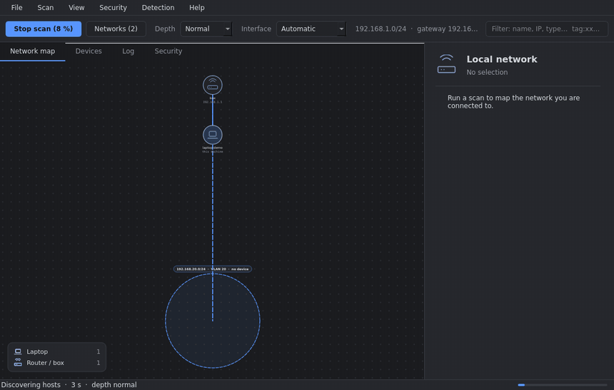

> The screenshots in this repository come from a **fictional network** (`tools/make_screenshots.py`), never from a real one.

## Try it in 10 seconds

    ./run.sh --demo        # fictional network: nothing is scanned, no configuration is read or written

## Features

- **Device detection**: ARP discovery, SSDP/UPnP, mDNS/Bonjour, WS-Discovery (ONVIF cameras, printers, Windows PCs), NetBIOS,
  HTTP(S) page title and `realm`, **HTTPS certificate** (brand, model, expiry), local DHCP leases; vendor (IEEE database),
  ports, banners, operating system, readable model (“iPhone14,2” → “iPhone 13 Pro”); **score-based** classification with a
  confidence level and the list of clues (“why is this a printer”), one icon per type (phone, tablet, TV, printer, console,
  speaker, camera, NAS, switch, router…). Name and type can be corrected by hand, and **custom detection rules** live in a JSON
  file (`docs/RULES.md`): right-click a device → “Create a detection rule…”.
- **Three maps**: *star* around this machine, *hierarchical* (Internet → router → switch → devices) or *grouped by device
  type*; your path to the Internet is drawn in blue, node positions are remembered per layout. A **mini-map** appears when
  you zoom in (click or drag it to move), **Shift-drag** selects several devices (or **Ctrl-click**), and a selection can be
  trusted or tagged in one go; *View → Center on selection* (`Ctrl+Shift+0`) finds a device again.
- **Several networks and VLANs**: networks the machine is already connected to (other interfaces, routes, VLANs) are scanned automatically, tagged VLANs through ARP (MAC, vendor, type); ranges typed by hand or detected (routes, 802.1Q interfaces, gateways), traceroute path,
  warning when a network does not answer, read-only **SNMP** (MAC addresses and switch ports of other VLANs), **LLDP/CDP**
  neighbours.
- **IPv6 (addresses)**: the IPv6 addresses of each device (read from the kernel neighbour table after one multicast ping) are shown in the panel and exported; discovery itself is still IPv4.
- **Scan profiles**: save ranges, depth, interface, SNMP hosts and options under a name (Scan → Scan profiles); a profile never stores a secret and never grants the security-analysis consent.
- **Monitoring**: **ARP** discovery (normal scan ≈ 10 s), **presence** scan (≈ 2 s, almost no traffic) that reuses the details
  of the last full scan, stoppable scans, quick / normal / thorough depth, automatic scan (presence + one full scan per
  hour), *offline* devices, *new* devices with a desktop notification.
- **History** (SQLite): presence over the last scans, availability, **latency curve** (from the ping of each full scan), event log (new device, IP change, offline, back…),
  **trusted** devices, **comparison of two scans**, **duplicate merging** (a “private” MAC that changes: automatic
  suggestion, aliases kept), configurable size and purge.
- **Optional read-only security analysis**: sensitive ports, services reachable without a password, obsolete services, with
  severity and recommendation; new and fixed exposures in the log.
- **Organisation**: tags, notes and groups per device (“kids”, “home automation”) with matching filters; Wake-on-LAN for an
  offline device.
- **Alerts** (Discord / Slack / ntfy / JSON webhook, or SMTP e-mail): one grouped message per scan for a new device, a new
  exposure or a trusted device going offline; the webhook URL and the SMTP password are stored in the system keyring (or a
  private file), never in the settings.
- **Day to day**: a banner when a scan finds new devices (*Show*, or *Name…* with a suggested name such as “Téléphone Samsung”) and *File → Period summary* (new, offline, exposures over 24 h / 7 / 30 days).
- **Reports**: PDF (summary, map, changes, devices, exposure), Markdown (security), enriched JSON and CSV, map as PNG or SVG;
  **scheduled PDF report** (daily or weekly) in a chosen folder, with the oldest ones removed (File → “Scheduled reports…”).
- **Vendor database**: update from the menu (IEEE), with confirmation.
- **Privacy**: listen-only mode (no probe sent), “Erase everything” for the history, SNMP community in the system keyring,
  data folder in mode 700 and database/log in mode 600 (see [SECURITY.md](SECURITY.md)).
- **Accessibility**: theme that follows the system (or dark, light, **high contrast**; every theme is checked against WCAG
  contrast ratios by the tests), adjustable **text size**, visible keyboard focus, a map you can walk with the arrow keys
  (Enter edits, Esc clears, `+`/`−` zoom), and a *Devices* tab that lists the same devices as a table for screen readers. A
  first-launch window only asks for the language; scan depth (deep by default), listen-only and the security analysis (on by default) are in the *Scan* menu.
- **Interfaces**: Qt window (English or French), local web interface, command line.

## Screenshots

| Star map | Hierarchical map |
|---|---|
| 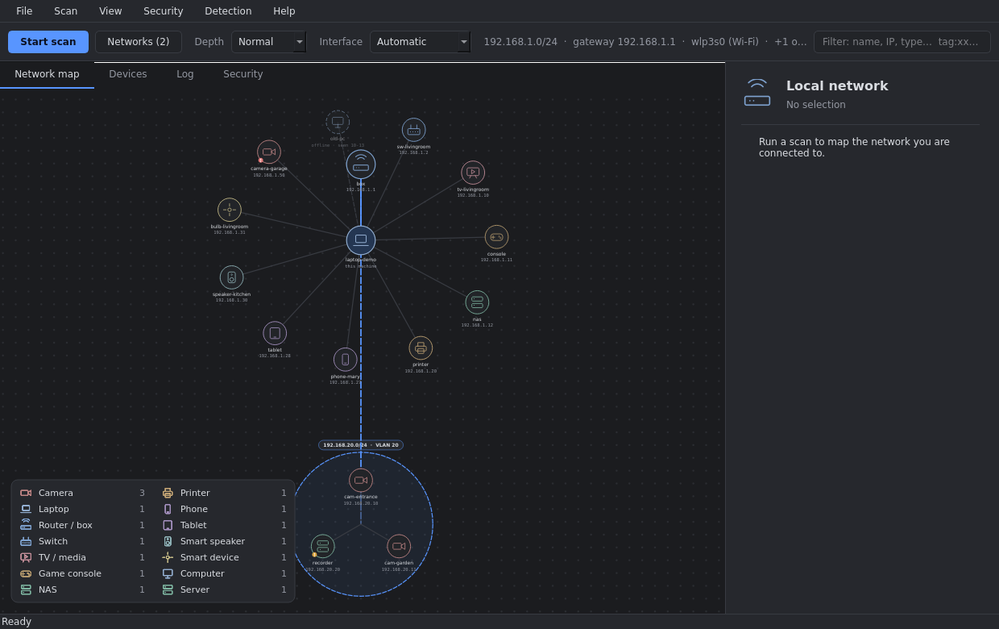 | 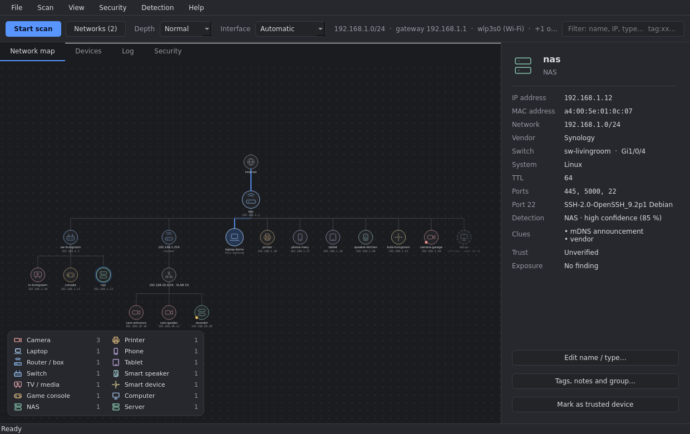 |
| **Device details** | **Device list** |
| 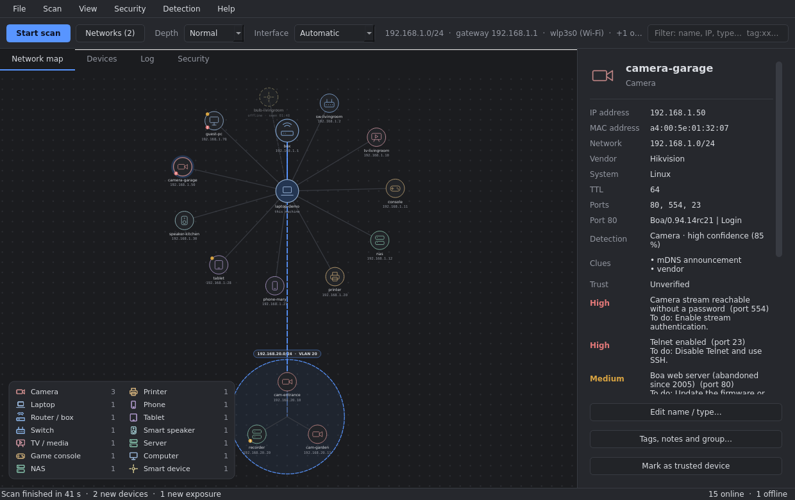 | 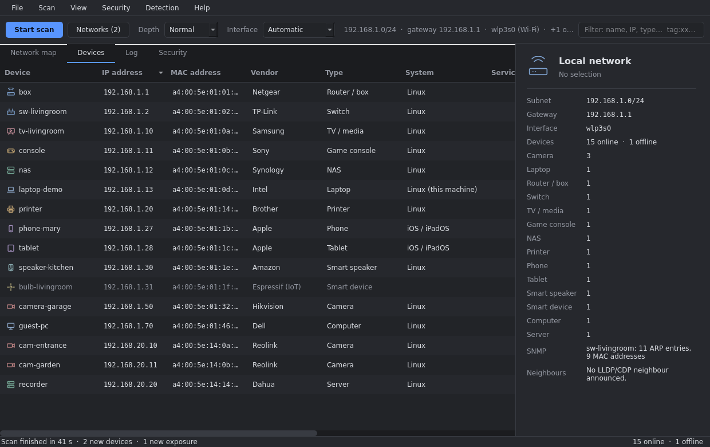 |
| **Grouped by type** | **Zoom, mini-map, multi-selection** |
| 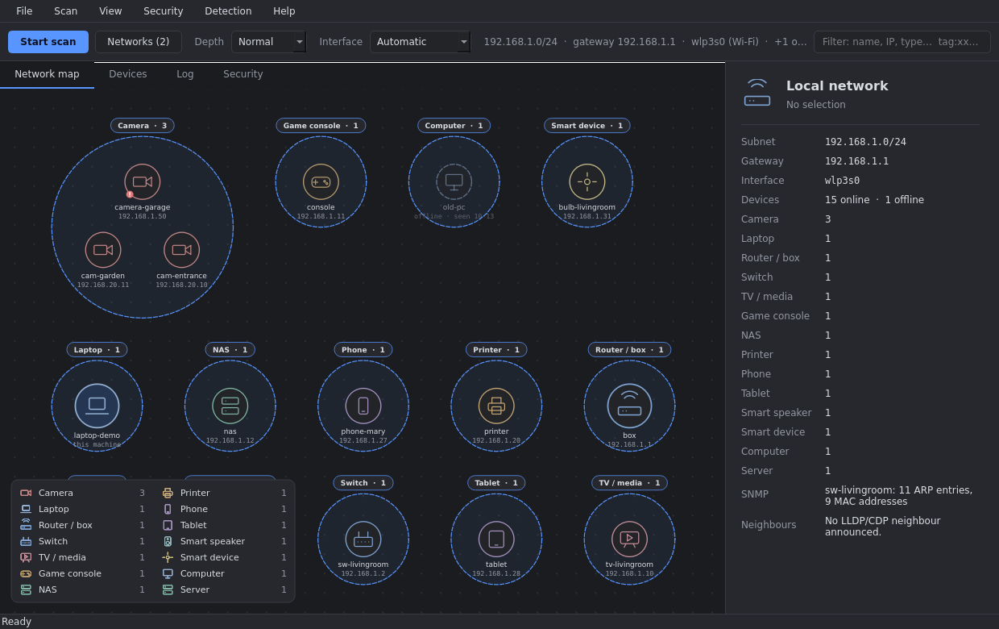 | 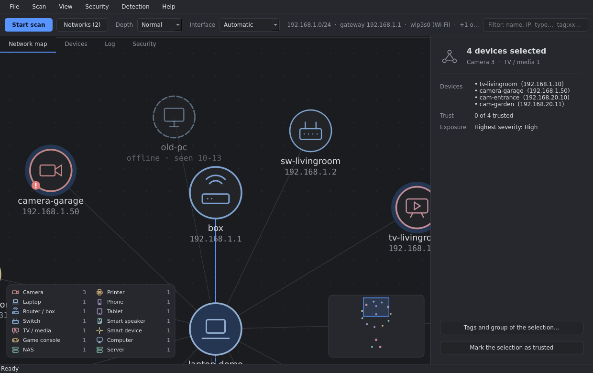 |
| **Log** | **Security analysis** |
| 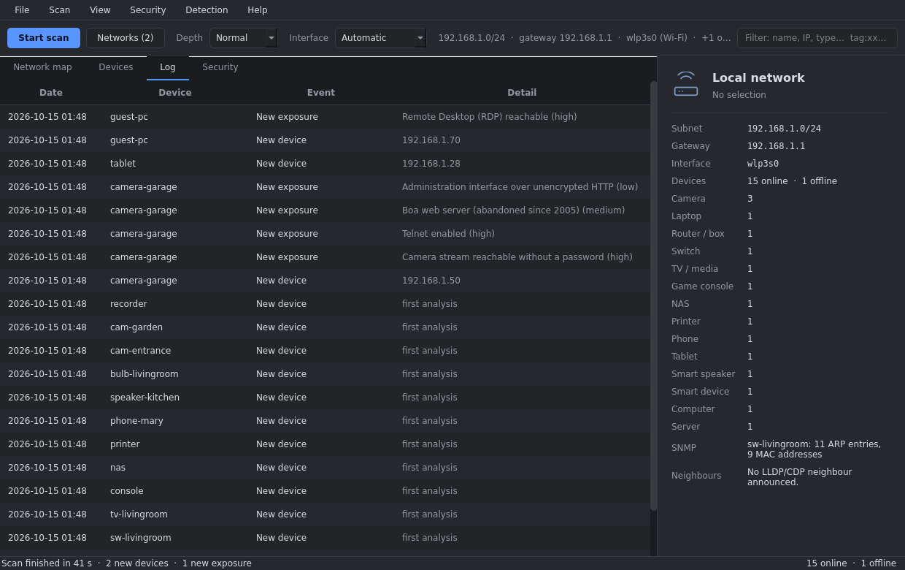 | 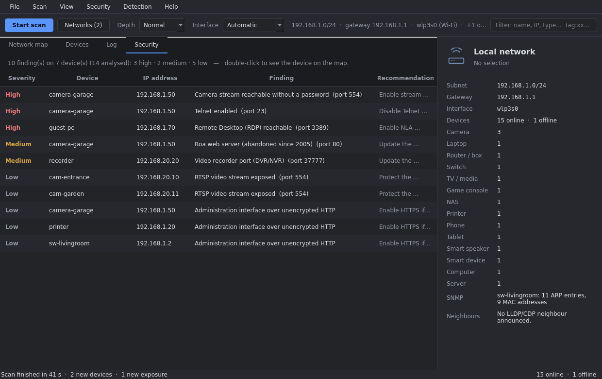 |
| **Compare two scans** | **PDF report** |
| 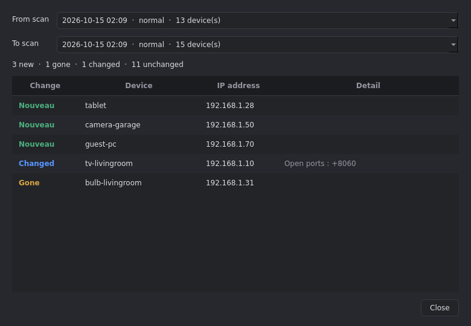 | 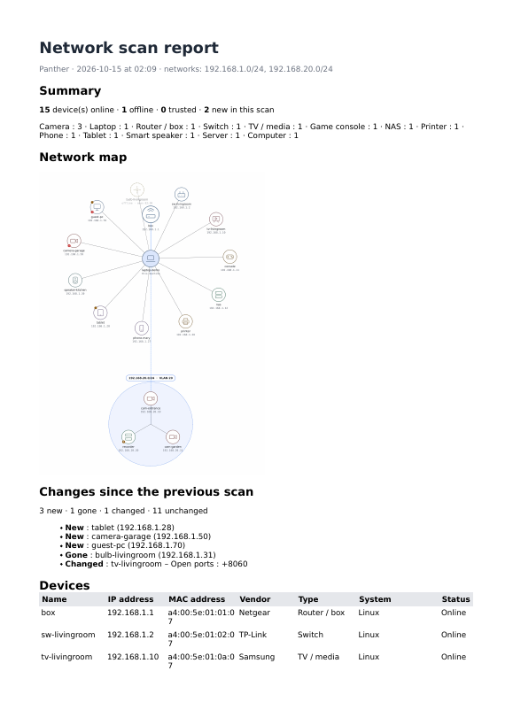 |

## Installation

Linux, Python ≥ 3.12. No root needed to scan (except for LLDP/CDP listening, see below).

**From source**

    ./run.sh                  # creates .venv, installs PyQt6 on first run, opens the window

**With pipx**

    pipx install .            # or: pipx install dist/panther_netscan-0.1.0-py3-none-any.whl
    panther

**Debian / Ubuntu package** (uses the system `python3-pyqt6`, no bundled Qt)

    ./packaging/build-deb.sh
    sudo apt install ./dist/panther-netscan_0.1.0_all.deb

## Usage

    panther                          # window
    panther --web [--port 8765]      # local web interface (127.0.0.1 only)
    panther --cli                    # table in the terminal
    panther --cli --depth rapide --target 192.168.20.0/24 --iface eth0
    panther --cli --security         # + security analysis (read-only)
    panther --verbose                # detailed log on the console
    panther --demo                   # fictional network to try the interface (no scan, no configuration touched)
    panther --lang en                # interface language (fr or en); default: the saved choice, then the system's

In the window: `Ctrl+R` starts the scan, `Ctrl+.` stops it, `Ctrl+0` recenters the map, `Ctrl+Shift+0` centers it on the selection; right-click a device to rename it,
change its type or mark it as trusted. The language is chosen in the *View → Language* menu (applied at the next start).

## How it works

| Module (`panther/`) | Role |
|---|---|
| `scanner.py` | engine: ARP/TCP discovery, depth profiles, presence, cancellation, analysis of each device |
| `discovery.py`, `dhcp.py` | SSDP/UPnP, mDNS/Bonjour, WS-Discovery (packet parsing written by hand); DHCP leases |
| `fingerprint.py`, `rules.py`, `models.py` | vendor (OUI), system, score-based classification; custom rules; model names |
| `networks.py`, `topology.py` | interfaces, VLANs, ranges; traceroute, LLDP/CDP neighbours |
| `snmp.py`, `snmpv3.py` | read-only SNMP client: v2c, and v3 authNoPriv (BER and USM written by hand) |
| `profiles.py` | saved scan profiles |
| `security.py` | exposure rules and unauthenticated checks |
| `history.py`, `store.py`, `compare.py`, `identity.py` | SQLite database (history, log, trust, positions, snapshots, aliases), manual settings, comparison, likely duplicates |
| `layout.py` | topology tree and hierarchical layout |
| `demo.py` | demo mode: fictional network, fake scan engine, temporary configuration |
| `i18n.py`, `lang_en.py`, `labels.py` | translation (French source text, English catalogue), device-type labels |
| `ui/` (`theme`, `icons`, `util`, `widgets`, `mapview`, `dialogs`, `settings_dialogs`, `wizard`, `window` + one mixin per role: `scan`, `mapctl`, `tables`, `panel`, `devices`, `reports`, `prefs`; `app`), `gui.py` | Qt interface, split by role (`gui.py` only re-exports the public names) |
| `reportpdf.py`, `log.py` | PDF report, error log |
| `server.py`, `static/` | local web interface |

Data: `~/.config/Panther/` (`panther.db` = history, `devices.json` = names and types set by hand, `rules.json` = detection
rules, `panther.log` = error log: device addresses and names, never a password or SNMP community; `--verbose` for details);
`panther/oui.txt` = vendor database.

### Languages

French is the source language of every text; `panther/lang_en.py` holds the English catalogue. `python3 tools/i18n_check.py`
(and `tests/test_i18n.py`) fail if a text has no translation, if a translation has stale entries or different placeholders,
and an offscreen test walks the whole English interface looking for French leftovers. Texts that are *stored* (the event
log, security findings recorded in history) keep the language they were written in.

### What the security analysis does

Disabled by default, enabled from the *Security* menu after an information message. Panther looks at open ports and banners,
and sends **a single read request without credentials** to a few services (Redis PING, Memcached `version`, Elasticsearch
`GET /`, Docker `GET /version`, RTSP `DESCRIBE`) to find out whether they answer without a password. It **does not try any
credentials, does not guess any password, does not exploit any vulnerability**. The versions announced by banners are clues:
on Linux, fixes are often backported, so the displayed version does not prove a flaw.

### Listen-only mode

*Security → Listen-only* menu (or `panther --cli --depth ecoute`): Panther sends **nothing** (no forced ARP, no TCP
connection, no SSDP/mDNS query, no name resolution, no SNMP, no traceroute, no security analysis). It reads the kernel's
neighbour table and the local DHCP leases and reuses the details of the last full scan. Devices never seen before appear with
their vendor (from the MAC) only; an old kernel entry can show a device that has just left for a few minutes.

### SNMP and LLDP/CDP (optional)

SNMP **v3** is supported at the *authNoPriv* level (user + password, HMAC-SHA/SHA-256/MD5, every request signed and every answer verified; keys are derived as in RFC 3414 and checked against its test vectors). There is no encryption (the standard library has no AES), so answers travel in clear text: use it on a trusted management network. The v3 password goes to the keyring like the v2c community.

The SNMP community is stored in the **system keyring** (`secret-tool`, GNOME Keyring / KWallet) when it is installed,
otherwise in a private file in mode 600; it is never written to the settings or the log. An old plain-text configuration is
migrated automatically. Still, only use a read-only community.

To see LLDP/CDP neighbours (switch name, port, VLAN), install **`lldpd`** (`sudo apt install lldpd`): Panther queries it
without any special privilege. Without `lldpd`, direct listening needs a raw socket (`cap_net_raw`); do not grant that
capability to the system Python interpreter (all your Python scripts would benefit from it). Without either, Panther says so
clearly and carries on.

## Limits

- Beyond a router, ARP does not pass: no MAC address or vendor, except through SNMP; mDNS/UPnP announcements do not cross
  routers either.
- Routing between VLANs and the firewall must let the probes through.
- Without SNMP or LLDP, all devices of the local network are attached to the router on the hierarchical map (Wi-Fi and
  cable cannot be told apart): Panther only draws the links it knows.
- A device whose MAC address changes (phones' “private” MAC) appears as a new device.

## Ethical and legal use

Only use Panther on networks **you are responsible for or have written permission to scan**. Scanning a network that is not
yours may be illegal. As a precaution, Panther refuses public address ranges, limits the size of ranges, only listens on
`127.0.0.1` for its web interface and never tries to log in to a device with credentials. The authors accept no liability for
misuse.

## Development

    python3 -m unittest discover -s tests -t .                       # engine (standard library only)
    QT_QPA_PLATFORM=offscreen .venv/bin/python -m unittest discover -s tests -t .   # + interface and PDF (PyQt6)
    python3 tools/i18n_check.py                                      # every text is translated
    python3 tools/lab.py [--hosts 200] [--snmp]                      # scan a virtual network (VLANs, router, SNMP, LLDP), no root needed
    ruff check panther tests tools && mypy                           # static analysis (see CONTRIBUTING.md)
    python3 tools/update_oui.py                                      # update the vendor database (IEEE)
    QT_QPA_PLATFORM=offscreen .venv/bin/python tools/make_screenshots.py [fr|en]   # regenerate screenshots and GIF (fictional network)

Continuous integration ([.github/workflows/ci.yml](.github/workflows/ci.yml)) runs the tests on Python 3.12 and 3.13, the
offscreen interface tests, then builds the wheel and the `.deb`. See [CHECKLIST.md](CHECKLIST.md) for the project's path
and [AMELIORATIONS.md](AMELIORATIONS.md) for what comes next (both in French).

## Licence

[MIT](LICENSE) © 2026 0xSystem32
